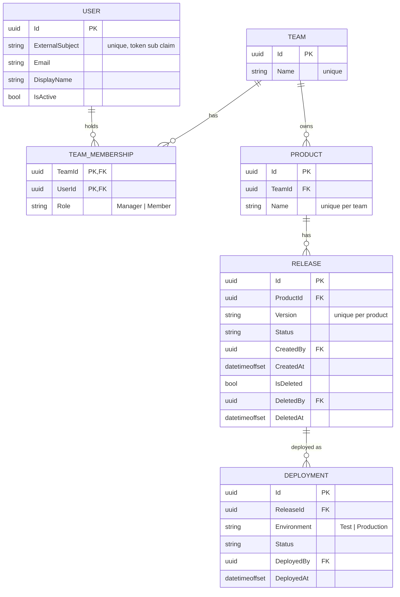
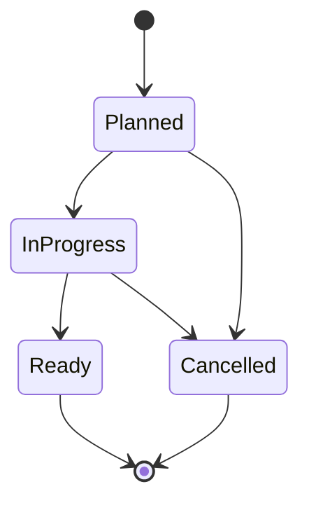
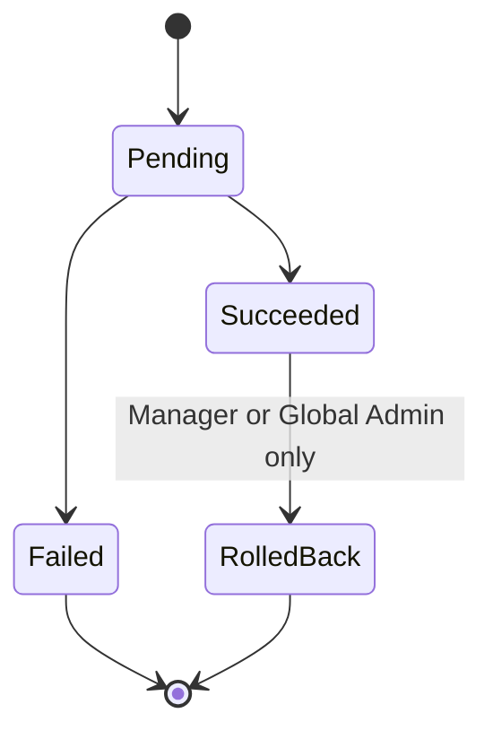

# Domain Model

## Entity relationships

`OutboxMessage (Id, Type, Payload, CreatedAt, ProcessedAt)` is a technical table for the worker and is not part of the domain.

## Relationships

| Relationship | Cardinality | Notes |
|---|---|---|
| Team → Product | 1 : n | A product belongs to exactly one team |
| Team ↔ User | n : m via `TeamMembership` | Membership carries the role (`Manager` / `Member`) |
| Team → Manager | 1 : n (at least 1) | A team must always keep at least one manager |
| Product → Release | 1 : n | Version is unique per product |
| Release → Deployment | 1 : n | One release can be deployed to several environments over time |

Members belong to the **team**, not to a manager. Removing a manager does not affect the other members.

## Release status

Release status describes the release's lifecycle. Where it runs is tracked by deployments.

## Deployment status

## Domain rules

1. A release can be deployed to `Production` only if it has a `Succeeded` deployment to `Test`.
2. A release must be `Ready` before it can be deployed.
3. A deleted release cannot be deployed or updated.
4. Only a `Succeeded` deployment can be rolled back.
5. All timestamps are stored as UTC `DateTimeOffset`.
