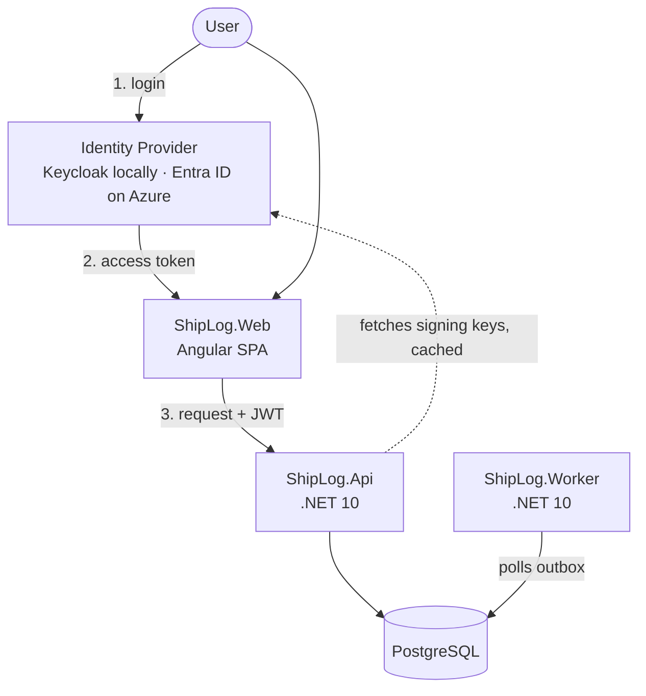

# System Overview

## Components

## Request flow

1. The user opens the Angular app and is redirected to the identity provider to log in (Authorization Code + PKCE).
2. The identity provider returns an access token to the SPA.
3. The SPA calls the API with the token in the `Authorization: Bearer` header.
4. The API validates the token **locally** (issuer, audience, signature, expiry) using signing keys it fetched once from the identity provider and caches. It does not call the identity provider on every request.
5. The API checks authorization (global role from the token, team role from the database) and reads or writes PostgreSQL.
6. Writes that trigger notifications store an `OutboxMessage` in the same transaction. The worker polls the outbox and processes messages.

## Environments

Two separate meanings, named differently in code and infrastructure:

| Term | Meaning | Values |
|---|---|---|
| **Deployment environment** (domain) | Where a tracked release is deployed | `Test`, `Production` |
| **Platform stage** (infrastructure) | Where ShipLog itself runs | `dev`, `prod` |
